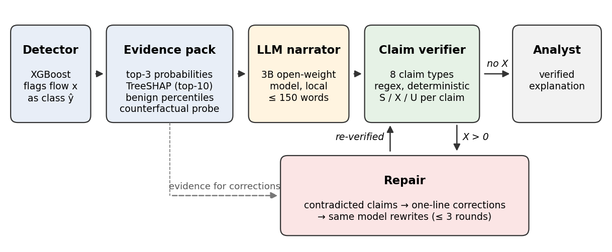

# Verify-then-Explain (VtE) [](https://doi.org/10.5281/zenodo.24066000)
    
Code and data for the paper **"Verify-then-Explain: Detecting and Repairing Unfaithful Large Language Model Explanations in Network Intrusion Detection"** by Muhammad Usama Nazir and Md. Asri Ngadi (Universiti Teknologi Malaysia). Manuscript under review.

VtE checks every claim an LLM makes when explaining an intrusion alert against the detector's own evidence (SHAP values, benign-traffic percentiles, class probabilities, a counterfactual probe), labels each claim supported, contradicted or unverifiable, and sends contradicted claims back to the model for repair.



## Main results

| | CICIoT2023 | UNSW-NB15 |
|---|---|---|
| High/low feature claims contradicted (6 model-condition cells per dataset) | 34.8-50.5% | 40.9-60.1% |
| Verifier: injected errors detected | 94.3% | 95.8% |
| Verifier: false alarms on meaning-preserving edits | 0/500 | 0/500 |
| Contradiction rate before -> after repair (full-evidence prompts) | 11.0-11.5% -> 3.2-3.5% | 8.5-11.8% -> 2.2-3.9% |

## Repository layout

```
scripts/        step0 ... step7 Python scripts and the Windows .bat runners
results/
  detectors/    trained XGBoost models, metrics.json, confusion matrices
  manifests/    data-preparation manifests (rows removed, class counts, splits)
  evidence/     evidence packs (one JSON line per alert)
  generations/  3,600 LLM explanations + the 20-alert development pilot
  verified/     claim-level verifier labels and per-condition summaries
  repairs/      verify-and-repair rounds for every full-evidence explanation
  sufficiency/  masked-reader answers
  error_injection/  verifier validation cases and summaries
figures/        paper figures
```

## Reproduce

Requirements: Python 3.12, `pip install -r requirements.txt`, and [Ollama](https://ollama.com) for the LLM steps. A GPU is not required; all results in the paper were produced on an Intel Core i7-1255U laptop with 40 GB RAM.

1. Download the datasets from their providers (not redistributed here):
   - CICIoT2023 (per-capture CSV release): https://www.unb.ca/cic/datasets/iotdataset-2023.html
   - UNSW-NB15 (training-set and testing-set CSVs): https://research.unsw.edu.au/projects/unsw-nb15-dataset
2. `python scripts/step1_prepare_data.py ...` and `python scripts/step1_train_detector.py ...` (data and detectors)
3. `python scripts/step2_evidence_packs.py ...` (evidence packs)
4. `ollama pull qwen2.5:3b`, `ollama pull llama3.2:3b`, then `scripts/run_step3_full.bat` (explanations, ~30 h on CPU)
5. `scripts/run_step4_5.bat` (verification, then repair)
6. `ollama pull gemma2:2b`, then `scripts/run_step7.bat` (sufficiency)
7. `python scripts/step6_error_injection.py ...` (verifier validation)

Exact command lines are at the top of each script. Seeds are fixed (data split 42, detector seeds 1-5, LLM seed 42, temperature 0).

## Licences

Code: MIT (see LICENSE). Derived data in `results/` (evidence packs, explanations, labels): CC BY 4.0. The evidence packs contain feature values derived from CICIoT2023 and UNSW-NB15; use them under those datasets' own terms and cite the original dataset papers.

## Citation

If you use this code or data, please cite the paper (citation will be added on publication) and see CITATION.cff.
